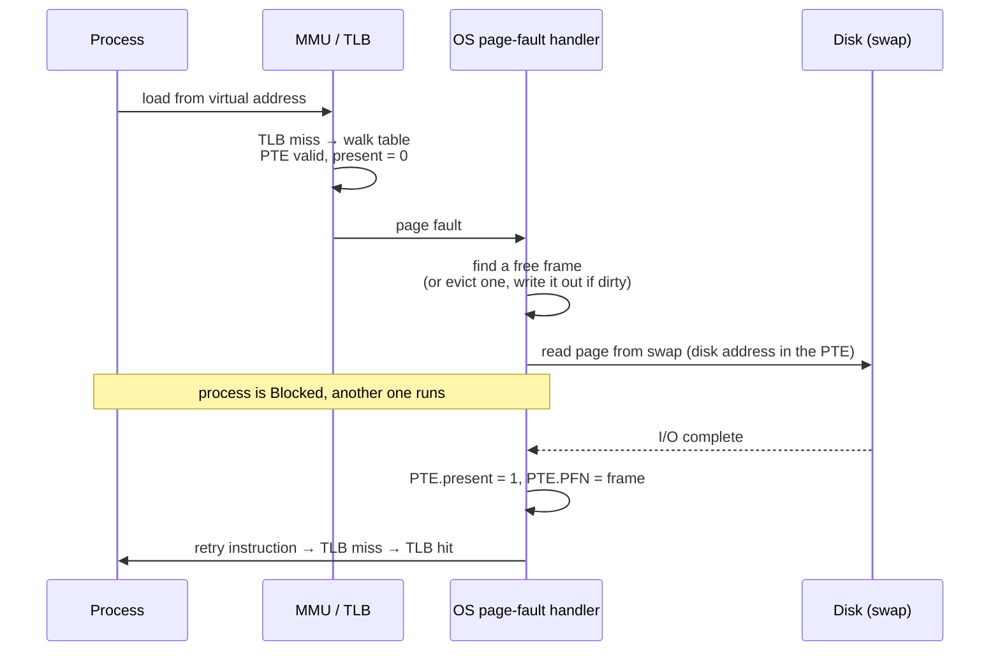

# L12 · Swapping: going beyond physical memory

> **Book:** Ch 21 (pp. 227–235) · Ch 22 (pp. 237–254) · **Tier:** 🔴 Must · Ch 23 ⚪ · **Time:** 55 min · **Simulator:** `vm-beyondphys-policy/paging-policy.py`

## TL;DR

- **Mechanism:** pages can live in **swap space** on disk. The PTE's **present bit** says whether a page is in memory. Touching a non-present page → **page fault** → the OS reads it from disk, updates the PTE, retries.
- **Policy:** when memory is full, evict a page. **OPT** (evict the page used furthest in the future) is the unbeatable benchmark; **LRU** approximates it using history; **Clock** approximates LRU cheaply with a **use bit**.
- If the working sets don't fit, the system **thrashes**. Evicting **clean** pages is cheaper than **dirty** ones.

## The crux

> How can the OS use a larger, slower device to give the illusion of a large virtual memory — and how does it decide which page to evict?

## The story chain

**Address spaces larger than RAM** → *store some pages on disk; present bit in the PTE* → *page fault handler loads the page* → ❌ memory full → *evict something* → *which? OPT* → ❌ needs the future → *FIFO* → ❌ ignores importance, and suffers **Belady's anomaly** → *Random* → ❌ luck-based → *LRU, uses history* → ❌ exact LRU means updating a data structure on **every** memory access → *Clock: a use bit set by hardware, a sweeping hand* → *prefer clean pages; evict in the background with a swap daemon* → ❌ too many processes for memory → *admission control or the OOM killer*.

## Core ideas

### The page-fault path

**When are pages evicted?** Not at the last moment: a background **swap daemon** (page daemon) keeps free memory between a **low watermark** and **high watermark**, evicting in batches (clustered writes are more efficient).

### Average memory access time

**AMAT = TM + Pmiss × TD** (TM = memory time, TD = disk time).

With TM = 100 ns and TD = 10 ms: a 90% hit rate gives ~1 ms; even 99.9% gives ~10.1 µs — **100× slower than memory**. Disk is so slow that only tiny miss rates are bearable.

### The policies

| Policy | Evicts | Notes |
|---|---|---|
| **OPT** (Belady) | Page used furthest in the future | Optimal; impossible in practice — use as a yardstick |
| **FIFO** | Oldest arrival | Simple; **Belady's anomaly**: more memory can mean more misses |
| **Random** | Any | Avoids worst cases; luck-based |
| **LRU** | Least recently used | Good with locality; a **stack algorithm** (no Belady's anomaly) |
| **LFU** | Least frequently used | Similar idea, frequency instead of recency |
| **Clock** | Sweep; page with use bit 0 (clear use bits as you pass) | Cheap LRU approximation. Variant also prefers clean (not dirty) pages |

### Workload lessons

- **No locality** (random): all realistic policies equal; only cache size matters.
- **80-20** (hot pages): LRU beats FIFO/Random.
- **Looping-sequential** over N+1 pages with a cache of N: LRU and FIFO **miss every time**; Random does much better.

### Other VM policy bits

- **Demand paging** (load when touched) vs **prefetching** (guess the next page).
- **Thrashing:** working sets exceed memory → constant paging. Fixes: run fewer processes (admission control) or kill one (Linux OOM killer).
- From VAX/VMS (Ch 23, two ideas only): **demand zeroing** (zero a page only when first touched) and **copy-on-write** (share pages after `fork()`, copy only on write — makes fork+exec cheap).

## Worked example (do by hand)

Reference string **0 1 2 0 1 3 0 3 1 2 1**, cache of 3 pages.

- **OPT:** misses on 0, 1, 2 (cold), 3 (evict 2, used furthest), 2 (evict 3 or 0) → **6 hits / 11 = 54.5%** (5 misses, 3 of them compulsory).
- **FIFO:** 0 1 2 miss; 0 1 hit; 3 miss (evict 0); 0 miss (evict 1); 3 hit; 1 miss (evict 2); 2 miss (evict 3); 1 hit → **4 hits = 36.4%**.
- **LRU:** 0 1 2 miss; 0 1 hit; 3 miss (evict 2); 0 3 1 hit; 2 miss (evict 0); 1 hit → **6 hits = 54.5%** — matches OPT here.

## Traps

- **Valid** but not **present** → page fault (normal). **Invalid** → segfault.
- Page faults are handled by the **OS** even on hardware-managed TLBs (disk I/O needs the OS).
- LRU has no Belady's anomaly; FIFO does.
- Evicting a **dirty** page costs a disk write first.

## Recall

**Blurt test:** the page-fault sequence; AMAT formula with the 99.9% example; the policy table; redo the FIFO trace.

What is the present bit?

A PTE bit saying whether the page is in physical memory (1) or swapped out to disk (0).

What happens on a page fault?

The OS finds a free frame (evicting one if needed), reads the page from swap, sets present=1 and the PFN, and the faulting instruction is retried. The process is blocked during the I/O.

Write the average memory access time formula.

AMAT = T_M + P_miss × T_D.

What does OPT evict and why can't we use it?

The page that will be used furthest in the future; it requires knowing the future.

What is Belady's anomaly?

With FIFO, increasing cache size can increase the number of misses. LRU and OPT (stack algorithms) don't have it.

How does the Clock algorithm work?

Pages in a circle with a hardware-set use bit. The hand sweeps: use bit 1 → clear it and move on; use bit 0 → evict.

Which workload makes LRU and FIFO miss every time?

Looping sequentially over one more page than the cache holds.

What is thrashing and how is it handled?

Memory is oversubscribed so the system spends its time paging. Run fewer processes (admission control) or kill one (OOM killer).

What is copy-on-write?

After fork, parent and child share pages read-only; a page is copied only when one of them writes to it.

**Explain it (60 s):** "Why does a 99.9% memory hit rate still make a program feel slow if the misses go to disk?"

**Simulator drill:** `python3 paging-policy.py -p FIFO -a 0,1,2,0,1,3,0,3,1,2,1 -C 3 -c`, then `-p LRU`, `-p OPT`, `-p CLOCK`.

## Connects to

- Present bit in the PTE → [L09](l09-paging.md)
- LRU-style caching → the buffer cache in [L23](../persistence/l23-vsfs.md)
- Disk speed numbers → [L20 Disks](../persistence/l20-disks.md)

## Read in the book

- 🔴 Ch 21: 21.1–21.6 (short).
- 🔴 Ch 22: 22.1–22.8 and 22.11. Do the workload figures in 22.6.
- ⚪ Ch 23 except 23.5 (demand zeroing, copy-on-write).
